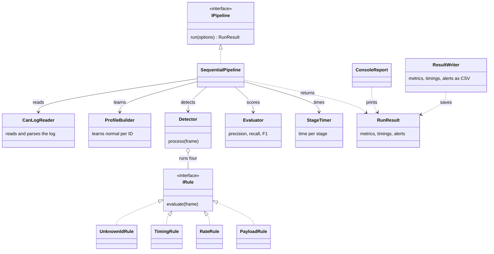
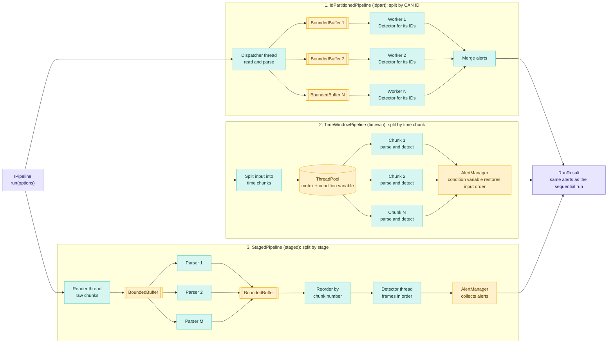
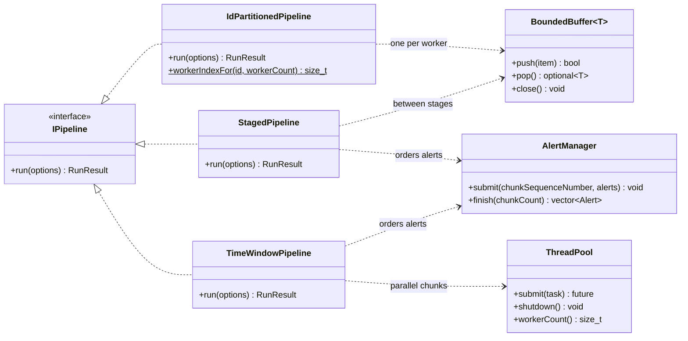
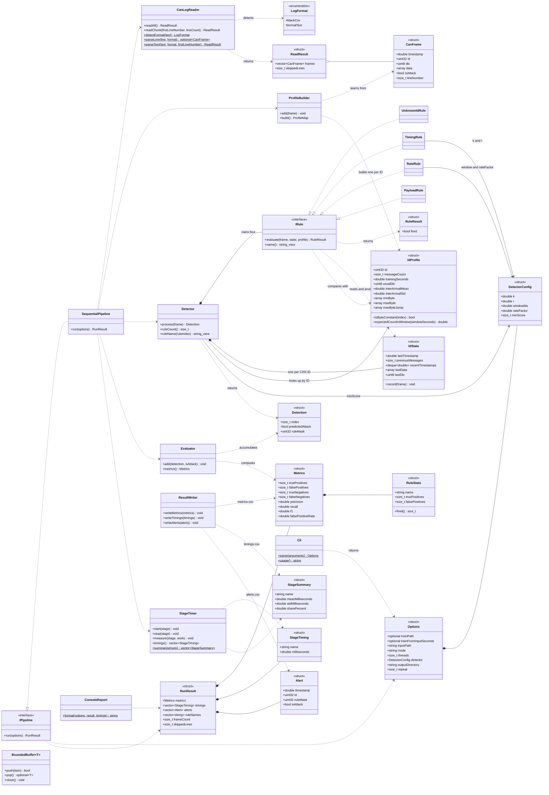

# CANGuard class diagrams

All diagrams are [Mermaid](https://mermaid.js.org/) and render on GitHub and in most Markdown viewers.

1. [Overview](#overview-phase-1): the 16 main classes and how they connect (start here).
2. [Phase 2 plan](#phase-2-headers-only-not-implemented-yet): the parallel classes that are declared but not built.
3. [Detailed Phase 1](#detailed-phase-1-every-class-and-struct): every class, struct and field from the specification.

## Overview (Phase 1)

One pass through the program: the pipeline reads the log, learns a profile per ID, runs every frame through the
detector and its four rules, scores the result and times each stage. The console report and the result writer
then present the run.

Colours: purple = pipeline and results, blue = input, teal = learning, amber = detection, pink = scoring and output.

`BoundedBuffer<T>` is finished and tested but not used by the sequential pipeline; the Phase 2 pipelines build on it.

## Phase 2 (headers only, not implemented yet)

The three parallel designs are declared in `include/canguard/` but not built. They all keep the Phase 1
detector; what changes is how the work is split across threads.

### Parallel flow

Read it left to right: every design starts from `IPipeline` and ends in the same `RunResult`. The three lanes are
stacked one above the other, and each lane is one design (chosen with `--mode`). Boxes stacked on top of each other
inside a lane run at the same time. Amber
boxes are the synchronisation points: `BoundedBuffer` (counting semaphores and a mutex) between threads, a mutex
and condition variable inside `ThreadPool`, and a condition variable in `AlertManager`.

What each design is for:

| Design | Splits the work by | Parallel part | Hard part |
|---|---|---|---|
| `idpart` | CAN ID | Detection (about 16% of the run) | Load balance: one ID can carry 16% to 19% of the traffic |
| `timewin` | Time chunk | Parsing and detection (about 91%) | State at chunk borders: warm-up overlap or hand-off between chunks |
| `staged` | Pipeline stage | Parsing (about 75%) | Keeping frames in order between the parsers and the detector |

### Class relationships

Teal = the parallel pipelines and the thread pool, green = synchronisation classes, purple = the shared interface.

## Detailed Phase 1: every class and struct

Same colours as the overview, plus green for `BoundedBuffer` (synchronisation).

Every class and struct from the specification, plus the small supporting types they pass around
(`ReadResult`, `Detection`, `Metrics`, `RunResult` and so on).

`BoundedBuffer<T>` is finished and tested but not used by the sequential pipeline; the Phase 2 pipelines
below build on it.
