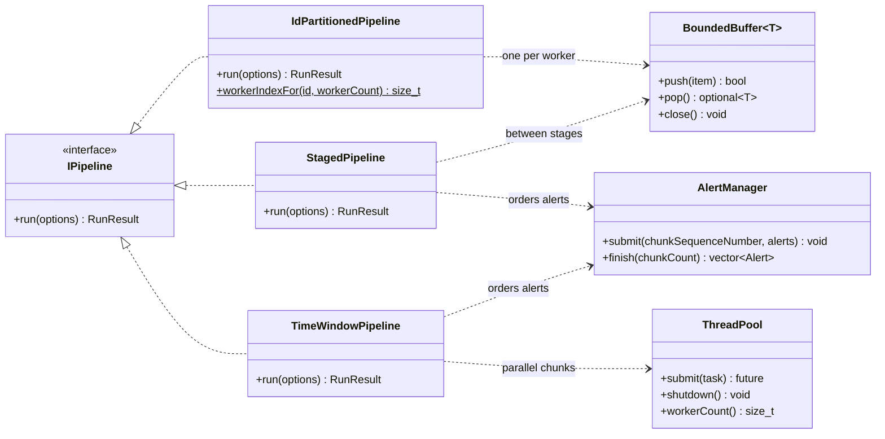

# CANGuard class diagrams

Both diagrams are [Mermaid](https://mermaid.js.org/) and render on GitHub and in most Markdown viewers.

## Phase 1 (implemented)

Every class and struct from the specification, plus the small supporting types they pass around
(`ReadResult`, `Detection`, `Metrics`, `RunResult` and so on).

```mermaid
classDiagram
    direction LR

    %% ---- input ----
    class CanFrame {
        <<struct>>
        +double timestamp
        +uint32 id
        +uint8 dlc
        +array data
        +bool isAttack
        +size_t lineNumber
    }
    class LogFormat {
        <<enumeration>>
        AttackCsv
        NormalText
    }
    class ReadResult {
        <<struct>>
        +vector~CanFrame~ frames
        +size_t skippedLines
    }
    class CanLogReader {
        +readAll() ReadResult
        +readChunk(firstLineNumber, lineCount) ReadResult
        +detectFormat(text)$ LogFormat
        +parseLine(line, format)$ optional~CanFrame~
        +parseText(text, format, firstLineNumber)$ ReadResult
    }
    class AttackType {
        <<enumeration>>
        None
        Dos
        Fuzzy
        Spoof
    }
    class SyntheticConfig {
        <<struct>>
        +double durationSeconds
        +AttackType attack
        +uint64 seed
        +double firstBurstSeconds
        +double burstLengthSeconds
        +double burstGapSeconds
    }
    class SyntheticGenerator {
        +generate() vector~CanFrame~
        +writeCsv(frames, path)$ void
    }

    CanLogReader ..> LogFormat : detects
    CanLogReader ..> ReadResult : returns
    ReadResult o-- CanFrame
    SyntheticGenerator --> SyntheticConfig
    SyntheticConfig --> AttackType
    SyntheticGenerator ..> CanFrame : generates

    %% ---- learning ----
    class IdProfile {
        <<struct>>
        +uint32 id
        +size_t messageCount
        +double trainingSeconds
        +uint8 usualDlc
        +double interArrivalMean
        +double interArrivalStd
        +array minByte
        +array maxByte
        +array maxByteJump
        +isByteConstant(index) bool
        +expectedCountInWindow(windowSeconds) double
    }
    class ProfileBuilder {
        +add(frame) void
        +build() ProfileMap
    }

    ProfileBuilder ..> CanFrame : learns from
    ProfileBuilder ..> IdProfile : builds one per ID

    %% ---- detection ----
    class DetectorConfig {
        <<struct>>
        +double k
        +double r
        +double windowMs
        +double rateFactor
        +size_t minScore
    }
    class IdState {
        <<struct>>
        +double lastTimestamp
        +size_t previousMessages
        +deque~double~ recentTimestamps
        +array lastData
        +uint8 lastDlc
        +record(frame) void
    }
    class RuleResult {
        <<struct>>
        +bool fired
    }
    class IRule {
        <<interface>>
        +evaluate(frame, state, profile) RuleResult
        +name() string_view
    }
    class UnknownIdRule
    class TimingRule
    class RateRule
    class PayloadRule
    class Detection {
        <<struct>>
        +size_t index
        +bool predictedAttack
        +uint32 ruleMask
    }
    class Detector {
        +process(frame) Detection
        +ruleCount() size_t
        +ruleName(ruleIndex) string_view
    }

    IRule <|.. UnknownIdRule
    IRule <|.. TimingRule
    IRule <|.. RateRule
    IRule <|.. PayloadRule
    IRule ..> RuleResult : returns
    IRule ..> IdState : reads and prunes
    IRule ..> IdProfile : compares with
    TimingRule --> DetectorConfig : k and r
    RateRule --> DetectorConfig : window and rateFactor
    Detector *-- IRule : owns four
    Detector *-- IdState : one per CAN ID
    Detector --> IdProfile : looks up by ID
    Detector --> DetectorConfig : minScore
    Detector ..> Detection : returns

    %% ---- evaluation and output ----
    class RuleStats {
        <<struct>>
        +string name
        +size_t truePositives
        +size_t falsePositives
        +fired() size_t
    }
    class Metrics {
        <<struct>>
        +size_t truePositives
        +size_t falsePositives
        +size_t trueNegatives
        +size_t falseNegatives
        +double precision
        +double recall
        +double f1
        +double falsePositiveRate
    }
    class Evaluator {
        +add(detection, isAttack) void
        +metrics() Metrics
    }
    class StageTiming {
        <<struct>>
        +string name
        +double milliseconds
    }
    class StageSummary {
        <<struct>>
        +string name
        +double meanMilliseconds
        +double stdMilliseconds
        +double sharePercent
    }
    class StageTimer {
        +start(stage) void
        +stop(stage) void
        +measure(stage, work) void
        +timings() vector~StageTiming~
        +summarize(runs)$ vector~StageSummary~
    }
    class Alert {
        <<struct>>
        +double timestamp
        +uint32 id
        +uint32 ruleMask
        +bool isAttack
    }
    class ResultWriter {
        +writeMetrics(metrics) void
        +writeTimings(timings) void
        +writeAlerts(alerts) void
    }

    Metrics *-- RuleStats
    Evaluator ..> Detection : accumulates
    Evaluator ..> Metrics : computes
    StageTimer ..> StageTiming
    StageTimer ..> StageSummary
    ResultWriter ..> Metrics : metrics.csv
    ResultWriter ..> StageSummary : timings.csv
    ResultWriter ..> Alert : alerts.csv

    %% ---- pipeline and command line ----
    class Options {
        <<struct>>
        +optional trainPath
        +optional trainFromInputSeconds
        +string inputPath
        +string mode
        +size_t threads
        +DetectorConfig detector
        +string outputDirectory
        +size_t repeat
    }
    class Cli {
        +parse(arguments)$ Options
        +usage()$ string
    }
    class RunResult {
        <<struct>>
        +Metrics metrics
        +vector~StageTiming~ timings
        +vector~Alert~ alerts
        +vector~string~ ruleNames
        +size_t frameCount
        +size_t skippedLines
    }
    class IPipeline {
        <<interface>>
        +run(options) RunResult
    }
    class SequentialPipeline {
        +run(options) RunResult
    }
    class ConsoleReport {
        +format(options, result, timings)$ string
    }
    class BoundedBuffer~T~ {
        +push(item) bool
        +pop() optional~T~
        +close() void
    }

    Cli ..> Options : returns
    Options *-- DetectorConfig
    IPipeline <|.. SequentialPipeline
    IPipeline ..> Options
    IPipeline ..> RunResult
    RunResult *-- Metrics
    RunResult *-- StageTiming
    RunResult *-- Alert
    SequentialPipeline ..> CanLogReader
    SequentialPipeline ..> ProfileBuilder
    SequentialPipeline ..> Detector
    SequentialPipeline ..> Evaluator
    SequentialPipeline ..> StageTimer
    ConsoleReport ..> RunResult
```

`BoundedBuffer<T>` is finished and tested but not used by the sequential pipeline; the Phase 2 pipelines
below build on it.

## Phase 2 (headers only, not implemented yet)

